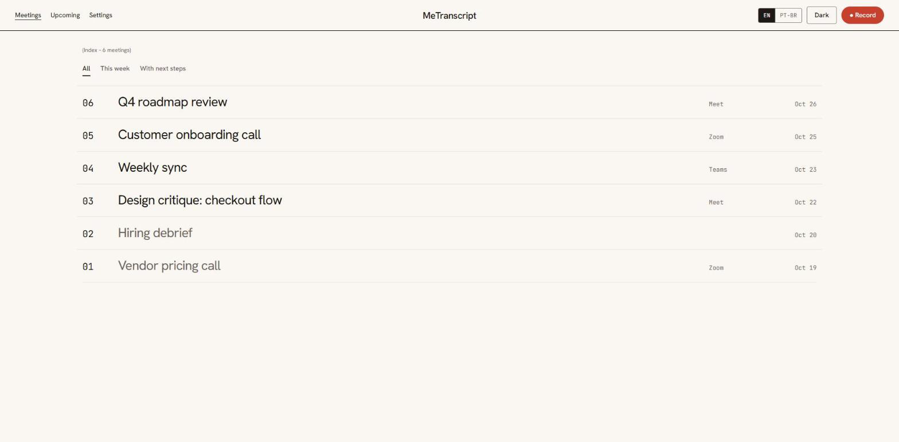
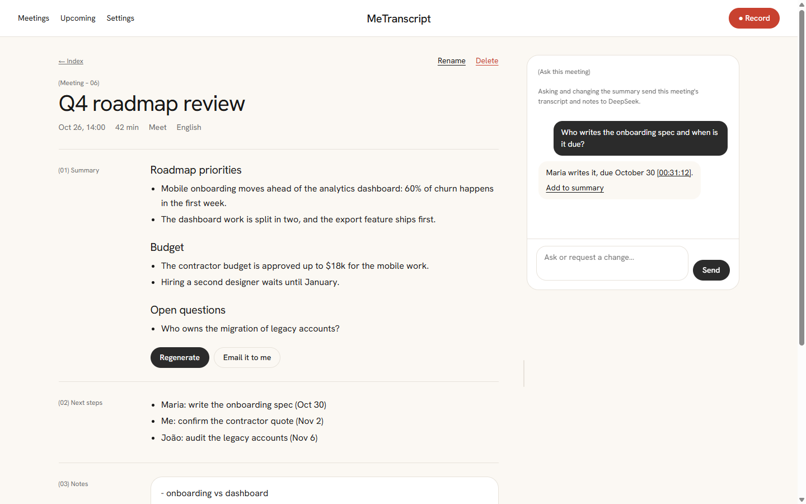
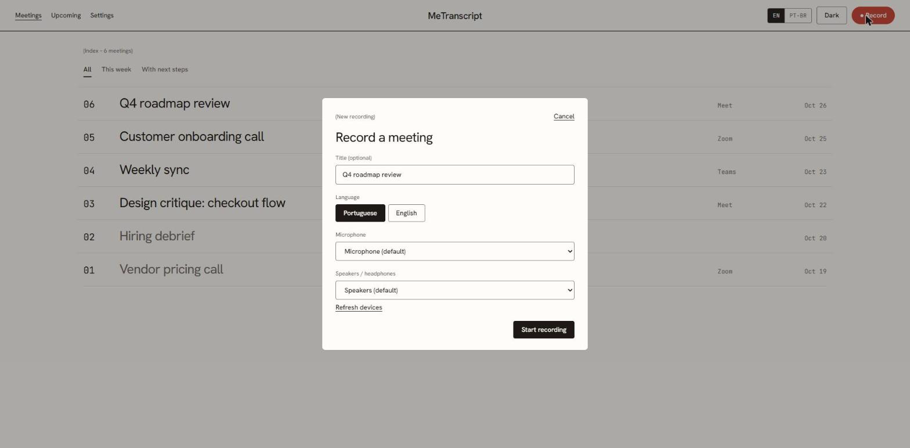
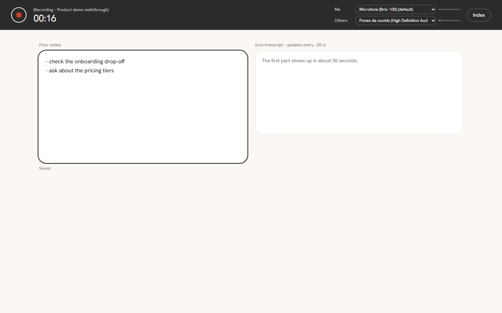
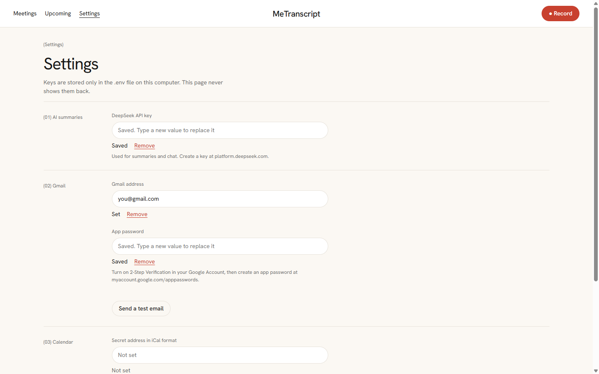

# MeTranscript

Personal meeting notes for Windows. Records Meet, Zoom and Teams without a bot, transcribes on your
computer (whisper.cpp on the GPU) and, at the end, DeepSeek summarizes the ideas by topic. Then you
chat with the meeting: ask something specific, add something to the summary or rephrase it.

Only the DeepSeek API is paid. Audio, transcripts and summaries stay in `meetings/`, in Markdown.

## Screenshots

The screenshots use demo meetings, not real data.

**Index**: every meeting as a numbered list, with filters.



**Meeting**: the summary by topic, the next steps, your notes and the transcript, with a resizable chat
on the side. Times like `[00:31:12]` in the answers jump to that line of the transcript.



**Record**: pick the language and the devices.



**Recording**: a strip stays on top of every page with the clock, the devices in use (switch them
mid-meeting) and level meters. Take notes while the live transcript fills in.



**Settings**: paste the keys once. They are saved to `.env` and never shown back.



## Requirements

- Windows 10/11, always wearing headphones in meetings (the app doesn't remove echo).
- Python 3.13 and ffmpeg on the `PATH` (`winget install Gyan.FFmpeg`).
- A [DeepSeek](https://platform.deepseek.com/) API key.
- For an AMD/Intel/NVIDIA GPU via Vulkan: CMake, Vulkan SDK and VS 2022 Build Tools (C++).

## Installation

```powershell
python -m pip install -r requirements.txt
```

### Keys: use the Settings page

Open **Settings** in the top bar and paste your keys there; they are written to the `.env` file at the
project root (already in `.gitignore`) and the page never shows them back. Each key appears as
"Saved" / "Not set", and **Remove** deletes it. Changes apply without restarting. A key set as a
Windows environment variable overrides `.env`, so that field is locked on the page.

You can still edit `.env` by hand; the names are below.

### DeepSeek key

In Settings → **(01) AI summaries**, or in `.env`:

```
DEEPSEEK_API_KEY=sk-...
```

### Summary in your Gmail (optional)

1. Turn on 2-Step Verification in your Google Account.
2. Create an app password at https://myaccount.google.com/apppasswords (name: "MeTranscript").
3. Paste both in Settings → **(02) Gmail** (use **Send a test email** to check), or add to `.env`:

```
GMAIL_ADDRESS=you@gmail.com
GMAIL_APP_PASSWORD=xxxx xxxx xxxx xxxx
```

Each new summary arrives in your inbox (body = summary, attachment = transcript). To turn it off, delete both lines; to revoke access, remove the app password
in your Google Account.

### Calendar reminders (optional)

MeTranscript can remind you 30 and 2 minutes before every meeting in your Google Calendar that has a
Meet, Zoom or Teams link; the 2-minute reminder has a **Record** button.

1. In Google Calendar, open **Settings → your calendar → Integrate calendar**.
2. Copy **Secret address in iCal format** and paste it in Settings → **(03) Calendar**, or add it to `.env` (comma-separate several calendars):

```
GOOGLE_CALENDAR_ICS=https://calendar.google.com/calendar/ical/.../basic.ics
```

Reminders only fire while MeTranscript is running: turn on **Run in background and start with
Windows** in Settings → **(05) App** (and use **Quit MeTranscript** to stop it). Treat the secret address like a
password; if it leaks, reset it in the same Google Calendar screen.

### Protecting sensitive data

Everything that goes to DeepSeek (summary and chat) is cleaned first, always, with no switch to turn it off:

- Emails, links, phone and ID numbers (CPF, CNPJ, cards), money amounts and API keys are replaced by codes
  like `[EMAIL_1]` or `[AMOUNT_1]` automatically.
- Names of clients, people and projects are replaced when you list them in Settings → **(04) Protected
  terms** (one per line, 3+ characters, a line starting with `# ` is a comment; the list lives in
  `sensitive-terms.txt`, which is not in git). Matching ignores case, accents and invisible characters, finds a
  name split by a line break, and catches a single word that Whisper misspells ("Falkon" for "Falcon").
- The answer comes back with the real names put back, on your computer. Each meeting shows how many
  items were hidden.

Limits: only what is on your list or matches those patterns is hidden, and Whisper can mishear a
multi-word name. Letters borrowed from another alphabet (a Cyrillic "а" in "Acme") are not recognized.
A plan described in ordinary words is not detected. The Gmail copy of the summary uses the
real names because it goes to your own inbox.

### Models (`models/` folder)

```powershell
curl.exe -L -o models/ggml-large-v3-turbo-q5_0.bin https://huggingface.co/ggerganov/whisper.cpp/resolve/main/ggml-large-v3-turbo-q5_0.bin
curl.exe -L -o models/ggml-silero-v5.1.2.bin https://huggingface.co/ggml-org/whisper-vad/resolve/main/ggml-silero-v5.1.2.bin
```

### whisper.cpp with Vulkan (recommended, keeps the video call smooth)

There's no official Vulkan binary for Windows, so build it once:

```powershell
winget install Kitware.CMake KhronosGroup.VulkanSDK
winget install Microsoft.VisualStudio.2022.BuildTools --override "--quiet --wait --norestart --add Microsoft.VisualStudio.Workload.VCTools --includeRecommended"
# open a new terminal to load VULKAN_SDK
git clone --depth 1 --branch v1.9.5 https://github.com/ggml-org/whisper.cpp bin/whisper-src
cmake -S bin/whisper-src -B bin/whisper-src/build -G "Visual Studio 17 2022" -A x64 -DGGML_VULKAN=ON -DWHISPER_SDL2=OFF
cmake --build bin/whisper-src/build --config Release -j 10 --target whisper-cli whisper-vad-speech-segments
mkdir bin/vulkan; copy bin/whisper-src/build/bin/Release/*.exe, bin/whisper-src/build/bin/Release/*.dll bin/vulkan/
```

No GPU: download `whisper-blas-bin-x64.zip` from
[release b5454](https://github.com/ggml-org/whisper.cpp/releases), extract it into `bin/` and use
`$env:ATA_WHISPER = "bin/Release/whisper-cli.exe"`. It works, but uses much more CPU.

## Usage

```powershell
python -m metranscript.server
```

Open http://127.0.0.1:8765 and keep the tab open.

1. The home page is the **Index**: every meeting as a numbered list, with filters (All, This week,
   With next steps).
2. Press **● Record** (or "Record this meeting" when Zoom, Teams or a browser starts using the
   microphone, or "Record" on an upcoming calendar meeting). Pick title, language, microphone and
   speakers (Windows defaults are preselected).
3. While recording, a dark strip stays on top of every page: clock, stop button, the devices in use
   (switch them there mid-meeting) and level meters. Take notes next to the live transcript; you can
   browse other meetings and come back with **Back to recording**.
4. Click the square to stop. The meeting opens as an article: (01) Summary, (02) Next steps,
   (03) Notes and (04) Transcript; if Gmail is configured, the summary also arrives in your inbox.
5. Use **Ask this meeting** on the right (drag its edge to make it wider): questions with clickable
   timestamps, "Add to summary", tweaks and **Undo**.
6. **Rename** or **Delete** a meeting from the links above its title (deleting asks for confirmation and
   removes the whole folder).

Each meeting lives in `meetings/YYYY-MM-DD_HHMM/` (`notes.md`, `transcript.md`, `summary.md`,
`chat.json`). When transcription finishes, the audio is compressed to `mic.opus` and `system.opus`
(about 11 MB per hour each) so you can press **Re-transcribe** later, for example after adding a name to
your protected terms; the old transcript is kept as `transcript.previous.md` and the summary is rewritten
(Undo brings the old one back). The compressed audio is deleted after 30 days. If transcription fails, the
original WAV stays in the folder.

## Configuration

| Variable | Default |
|---|---|
| `DEEPSEEK_API_KEY` | — |
| `ATA_WHISPER` | `bin/vulkan/whisper-cli.exe` |
| `ATA_MODEL` | `models/ggml-large-v3-turbo-q5_0.bin` |
| `ATA_VAD` | `models/ggml-silero-v5.1.2.bin` |
| `ATA_THREADS` | `4` |
| `ATA_PORT` | `8765` |
| `GMAIL_ADDRESS` / `GMAIL_APP_PASSWORD` | — (enables sending the summary by email) |

## Development

```powershell
python -m unittest
```

Project documentation, decisions (ADRs), backlog and standards in [`.claude/docs/`](.claude/docs/README.md).
